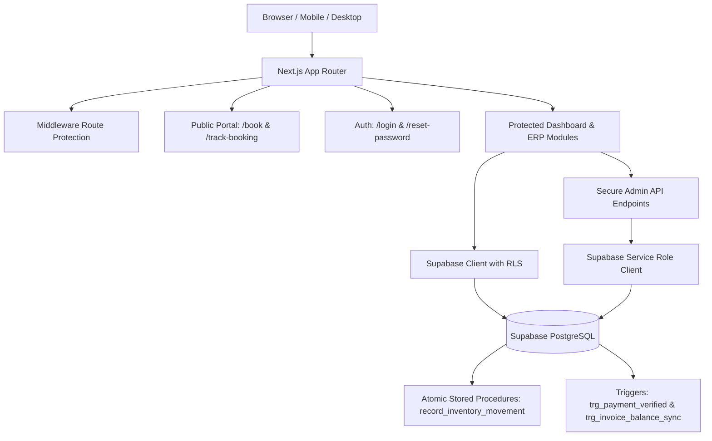

# DAYDAY Management System

> **DAYDAY SPARKLE AND SHINE CLEANING SERVICE**  
> *“Satisfaction Guaranteed.”*  
> Operating in Accra, Greater Accra, Ghana • Currency: Ghana Cedis (GH₵) • Timezone: Africa/Accra

---

## 1. Project Overview

The **DAYDAY Management System** is a complete, production-ready enterprise application designed to centralize and automate the daily operations, financial accounting, inventory control, field cleaning job dispatch, customer booking management, and employee payroll for **DAYDAY SPARKLE AND SHINE CLEANING SERVICE** in Ghana.

### Key Capabilities
- **Customer Booking Portal**: Public self-service booking portal with dynamic pricing by property scale, Ghanaian address & Ghana Post GPS support, booking tracking lookup.
- **Operations & Job Scheduling**: Approved bookings convert into jobs, employee crew dispatch, before-and-after photo attachments, materials consumed tracking, customer rating & reviews.
- **Financial & Accounting Management**:
  - Accrual basis Profit and Loss (P&L) statement.
  - Formula: $\text{Net Profit} = \text{Recognized Revenue} - \text{Recognized Expenses}$.
  - Invoices with automatic PDF print optimization and balance syncing.
  - Multi-channel Ghanaian payments: Mobile Money (MTN / Telecel), Bank Transfer (Ecobank / GCB), and Cash.
  - Payment verification and receipt generation.
- **Inventory & Asset Control**: Controlled stock movements (Purchases, Dispatch to Jobs, Damaged write-offs, Returns) backed by an atomic PostgreSQL stored procedure and low-stock reorder triggers.
- **Human Resources & Payroll**:
  - Clock in / clock out in `Africa/Accra` timezone with duplicate protection.
  - Complete monthly payroll batches applying the statutory formula:  
    $\text{Net Salary} = \text{Basic} + \text{Allowances} + \text{Overtime} + \text{Bonuses} - \text{Deductions}$.
  - Secure employee payslip portal where staff can view only their own records.
- **Contracts & Quality Assurance**: Recurring cleaning contracts, customer quality ticket tracking.
- **Analytics & Export**: CSV / Excel export across revenue, expenses, jobs, and inventory.

---

## 2. Technology Stack

- **Framework**: Next.js (App Router) with TypeScript & React 19
- **Styling**: Tailwind CSS (White & Professional Blue brand identity)
- **Database & Auth**: Supabase PostgreSQL with Row Level Security (RLS) & Supabase SSR Auth
- **Data Visualizations**: Recharts for monthly financial trends, revenue vs expenses, and category distributions
- **Icons**: Lucide Icons
- **Testing**: Node.js Test Runner (`node --test`) for deterministic business logic verification

---

## 3. Architecture & Security Model



### Security & Role-Based Access Control (RBAC)
1. **Administrator**: Full access to all revenue, expenses, profit & loss, customer CRM, all jobs, employee accounts, stock adjustments, and company settings.
2. **Employee**: Restricted by server-side authorization and database RLS. Employees can only:
   - View their own profile and assigned jobs.
   - Clock in and out for their daily shift.
   - Submit job completion reports, actual materials used, and before/after photos.
   - Submit expense claims for approval.
   - View only their own approved payslips.

---

## 4. Setup & Installation Guide

### Prerequisites
- Node.js v20+ or v24+
- npm v10+
- A Supabase project (Free or Pro tier)

### 1. Clone & Install Dependencies
```bash
git clone <repository-url>
cd "Cleaning Service"
npm install
```

### 2. Configure Environment Variables
Copy `.env.example` to `.env.local`:
```bash
cp .env.example .env.local
```

Update `.env.local` with your Supabase credentials:
```env
NEXT_PUBLIC_SUPABASE_URL=https://your-project.supabase.co
NEXT_PUBLIC_SUPABASE_ANON_KEY=your-anon-key
SUPABASE_SERVICE_ROLE_KEY=your-service-role-key

NEXT_PUBLIC_APP_NAME="DAYDAY Management System"
NEXT_PUBLIC_COMPANY_NAME="DAYDAY SPARKLE AND SHINE CLEANING SERVICE"
NEXT_PUBLIC_COMPANY_TAGLINE="Satisfaction Guaranteed."
NEXT_PUBLIC_DEFAULT_CURRENCY="GH₵"
NEXT_PUBLIC_TIMEZONE="Africa/Accra"
NEXT_PUBLIC_APP_URL=http://localhost:3000
```

### 3. Apply Database Migrations
In your Supabase Dashboard SQL Editor, run the SQL script found in:
`supabase/migrations/20261021000000_init_dayday_schema.sql`

This creates:
- All tables, constraints, foreign keys, and indexes.
- Row Level Security (RLS) policies for Admin, Employee, and Public roles.
- Triggers for automatic invoice balance recalculation and client balance synchronization.
- Atomic stored procedure `record_inventory_movement`.
- Initial seed data for company settings and standard cleaning services.

### 4. Run the Automated Test Suite
```bash
npm test
```

### 5. Start the Development Server
```bash
npm run dev
```
Open [http://localhost:3000](http://localhost:3000) in your browser.

### 6. Production Build Verification
```bash
npm run build
npm start
```

---

## 5. Main Business Workflows

### 1. Customer Online Booking Flow
1. Customer visits the landing page (`/`) and clicks **Book a Cleaner** (`/book`).
2. Customer selects a service (e.g. Deep Cleaning Service, Residential Clean, Office Clean), property size, preferred date, and time slot.
3. Customer enters contact details, street address, and Ghana Post GPS code.
4. System calculates a dynamic quote in GH₵, generates reference `BK-YYYYMM-XXX`, and confirms the request.
5. Customer can track their booking at `/track-booking?ref=BK-...`.

### 2. Administrator Booking Approval & Job Scheduling Flow
1. Administrator navigates to **Bookings** (`/bookings`).
2. Admin opens the inquiry, reviews customer notes, adjusts the agreed price, sets the start time, and selects cleaners from the active staff directory.
3. Admin clicks **Approve Booking & Create Job**.
4. The system automatically creates a CRM client profile, generates a job number (`JOB-YYYYMM-XXX`), and dispatches assigned crew members (`job_workers`).

### 3. Field Cleaner Job Execution Flow
1. Assigned employee logs in at `/login`.
2. Dashboard displays their assigned jobs for today with location and start time.
3. Employee arrives at the site, marks status **In Progress**, inputs actual materials used, uploads before-and-after cleaning photos, and marks the job **Completed**.
4. Customer rating and feedback are saved to the permanent quality record.

### 4. Invoicing & Payment Verification Flow
1. Admin visits the job page and clicks **Generate Invoice**.
2. An official branded invoice (`INV-YYYYMM-XXX`) is created with Ghanaian Mobile Money and Bank transfer payment details.
3. When customer transfers payment via MTN MoMo or Bank, Admin clicks **Record Payment**.
4. Database trigger automatically deducts the payment from invoice `balance_due`, updates status to `paid`, and reconciles the client's outstanding balance.

### 5. Inventory & Stock Audit Flow
1. Stock managers access `/inventory` to check stock on hand. Items below reorder thresholds display red **Low Stock Alert** badges.
2. Clicking **Adjust Stock** (`/inventory/adjust`) records intake or job dispatch through an atomic database procedure.
3. Every movement is logged in the permanent audit trail at `/inventory/movements`.

### 6. Staff Payroll & Salary Disbursement Flow
1. Admin opens `/payroll/new` and selects Month and Year.
2. System pulls active employee contracts and calculates basic wages + allowances.
3. Admin reviews proposed amounts and clicks **Approve Payroll**.
4. On payday, Admin clicks **Disburse & Mark Paid**. The system marks all items paid and automatically registers an operational salary expense in the P&L module.
5. Employees log in and view their personal payslips at `/payroll/my-payslips`.

---

## 6. Project Structure

```
Cleaning Service/
├── .env.example                       # Template environment configuration
├── .env.local                         # Local environment variables
├── package.json                       # Dependencies and test scripts
├── tailwind.config.ts                 # Theme colors (Professional Blue & White)
├── tsconfig.json                      # Strict TypeScript compiler options
├── supabase/
│   └── migrations/
│       └── 20261021000000_init_dayday_schema.sql  # Complete DB schema & RLS
├── tests/
│   └── business-logic.test.mjs        # 10 automated business logic tests
└── src/
    ├── app/
    │   ├── api/                       # Secure server-side API routes
    │   │   ├── admin/
    │   │   │   ├── bookings/          # Booking approval & conversion
    │   │   │   ├── employees/         # Provisioning & deactivation
    │   │   │   ├── expenses/          # Expense approval
    │   │   │   ├── inventory/         # Stock movement execution
    │   │   │   ├── invoices/          # Invoice generation from jobs
    │   │   │   ├── payments/          # Payment recording & verification
    │   │   │   ├── payroll/           # Payroll generation & approval
    │   │   │   └── settings/          # Company settings update
    │   │   └── jobs/update/           # Field job status & photo upload
    │   ├── book/                      # Public customer booking portal
    │   ├── bookings/                  # Admin booking review & approval
    │   ├── clients/                   # Customer CRM directory & profiles
    │   ├── complaints/                # Quality control tickets & complaints
    │   ├── contracts/                 # Recurring cleaning contracts
    │   ├── dashboard/                 # Executive & Operational dashboard
    │   ├── employees/                 # Staff directory & onboarding
    │   ├── expenses/                  # Operating expense tracker
    │   ├── finance/pnl/               # Accrual Profit & Loss statement
    │   ├── inventory/                 # Stock catalog, movements & adjustments
    │   ├── invoices/                  # Branded printable invoices & billing
    │   ├── jobs/                      # Operational cleaning jobs
    │   ├── login/                     # Branded secure sign in
    │   ├── payments/                  # Payment transactions & receipts
    │   ├── payroll/                   # Payroll batches & employee payslips
    │   ├── profile/                   # Staff user profile
    │   ├── reports/                   # Analytics & CSV exports
    │   ├── reset-password/            # Password recovery
    │   ├── settings/                  # Company settings
    │   ├── track-booking/             # Customer booking status tracker
    │   ├── update-password/           # Password update
    │   ├── globals.css                # Global styles & print rules
    │   ├── layout.tsx                 # Root layout
    │   └── page.tsx                   # Public landing page
    ├── components/
    │   └── layout/
    │       ├── DashboardLayout.tsx    # Responsive shell
    │       ├── Header.tsx             # Quick actions, alerts & profile
    │       └── Sidebar.tsx            # Role-based navigation
    ├── lib/
    │   ├── auth.ts                    # Server session & role helpers
    │   ├── utils.ts                   # Ghana cedis currency & date formatters
    │   └── supabase/                  # Browser, server & admin clients
    ├── middleware.ts                  # Next.js route protection middleware
    └── types/
        └── database.ts                # TypeScript interfaces & database models
```

---

## 7. License & Credits

Built for **DAYDAY SPARKLE AND SHINE CLEANING SERVICE**, Accra, Ghana.  
Tagline: *“Satisfaction Guaranteed.”*
